# ERD - Mongoose schemas

This diagram documents the 11 Mongoose models in `backend/src/modules`. The
model definitions are the source of truth; `ref` means a Mongoose reference
used by application code, not a MongoDB foreign-key constraint.

## Conventions

- `PK` is Mongoose's automatically created document `_id`.
- `UK` marks a schema field configured with `unique: true`; compound unique
  indexes are called out on their component fields.
- Field comments state required/optional, defaults, enums, validation details,
  embedded paths, and array element types. `optional` means the schema does not
  require the path; `default null` is shown separately where explicitly set.
- Inline object arrays are embedded subdocuments (with their own automatic
  `_id`); nested objects are embedded objects. Neither is a separate entity.
- Mongoose `timestamps` add `createdAt`/`updatedAt`, except `Favourite`, which
  enables only `createdAt`.
- Collections below use Mongoose's default model-name pluralization.

| Model | Collection |
|---|---|
| User | `users` |
| Customer | `customers` |
| Destination | `destinations` |
| Tour | `tours` |
| Guide | `guides` |
| Booking | `bookings` |
| BookingPlan | `bookingplans` |
| Favourite | `favourites` |
| Collection | `collections` |
| Contact | `contacts` |
| ChatSession | `chatsessions` |

```mermaid
erDiagram
    USER {
        ObjectId _id PK "Mongoose document primary key"
        String name "required; trim"
        String email UK "required; unique index; lowercase; trim; email match"
        String password "required; minlength 6; select false"
        String role "enum user|admin; default user"
        String avatar "default https://images.unsplash.com/photo-1535713875002-d1d0cf377fde?auto=format&fit=crop&w=150&q=80"
        Date createdAt "Mongoose timestamp"
        Date updatedAt "Mongoose timestamp"
    }

    CUSTOMER {
        ObjectId _id PK "Mongoose document primary key"
        ObjectId userId "ref User; optional; default null"
        String fullName "required; trim"
        String email "required; lowercase; trim; email match"
        String phone "required; trim"
        String address "optional; trim; default empty string"
        String city "optional; trim; default empty string"
        String country "optional; trim; default Việt Nam"
        String idCardNumber "optional; trim; default empty string"
        Date createdAt "Mongoose timestamp"
        Date updatedAt "Mongoose timestamp"
    }

    DESTINATION {
        ObjectId _id PK "Mongoose document primary key"
        String name "required; trim"
        String slug UK "optional; no schema default; unique index; lowercase; trim; generated from name on save"
        String region "required; trim"
        String theme "optional; trim; default General"
        String image "optional; default empty string"
        String location "optional; trim; default empty string"
        String climate "optional; trim; default empty string"
        String overview "optional; trim; default empty string"
        Array attractions "element String; default empty array"
        Array activities "element String; default empty array"
        String bestSeason "optional; trim; default empty string"
        String visitDuration "optional; trim; default empty string"
        String budgetBand "optional; trim; default empty string"
        String transport "optional; trim; default empty string"
        Array gallery "path gallery[]; embedded subdocuments; default empty array"
        ObjectId gallery_item_id "path gallery[]._id; automatic embedded subdocument key"
        String gallery_url "path gallery[].url; required"
        String gallery_caption "path gallery[].caption; default empty string"
        String gallery_alt "path gallery[].alt; default empty string"
        String gallery_credit "path gallery[].credit; default empty string"
        Array relatedDestinations "path relatedDestinations[]; element ObjectId; ref Destination; default empty array"
        Date createdAt "Mongoose timestamp"
        Date updatedAt "Mongoose timestamp"
    }

    TOUR {
        ObjectId _id PK "Mongoose document primary key"
        ObjectId destinationId "ref Destination; required"
        String title "required; trim"
        String slug UK "optional; no schema default; unique index; lowercase; trim; generated from title on save"
        String overview "optional; trim; default empty string"
        Array durationOptions "embedded subdocuments; default empty array"
        ObjectId durationOptions_item_id "path durationOptions[]._id; automatic embedded subdocument key"
        Number durationOptions_days "path durationOptions[].days; required; min 1"
        Number durationOptions_nights "path durationOptions[].nights; required; min 0"
        Number durationOptions_price "path durationOptions[].price; required; min 0"
        Array departureDates "element Date; default empty array"
        Number maxPassengers "required; default 20; min 1"
        Number availableSeats "optional; default maxPassengers or 20; min 0"
        Array itinerary "embedded subdocuments; default empty array"
        ObjectId itinerary_item_id "path itinerary[]._id; automatic embedded subdocument key"
        Number itinerary_day "path itinerary[].day; required"
        String itinerary_title "path itinerary[].title; required"
        String itinerary_description "path itinerary[].description; default empty string"
        Array includes "element String; default empty array"
        Array excludes "element String; default empty array"
        String status "enum active|inactive; default active"
        Date createdAt "Mongoose timestamp"
        Date updatedAt "Mongoose timestamp"
    }

    GUIDE {
        ObjectId _id PK "Mongoose document primary key"
        String name "required"
        String slug UK "optional; no schema default; unique index; lowercase; trim; generated from name on save"
        String background "optional; default empty string"
        String specialisation "optional; default empty string"
        String biography "optional; default empty string"
        Array languages "element String; default ['Tiếng Việt']"
        Array destinations "element ObjectId; ref Destination; default empty array"
        Date createdAt "Mongoose timestamp"
        Date updatedAt "Mongoose timestamp"
    }

    BOOKING {
        ObjectId _id PK "Mongoose document primary key"
        ObjectId userId "ref User; required"
        ObjectId customerId "ref Customer; optional; default null"
        ObjectId tourId "ref Tour; required"
        Number selectedDuration_days "embedded object path selectedDuration.days; default 1"
        Number selectedDuration_nights "embedded object path selectedDuration.nights; default 0"
        Number selectedDuration_price "embedded object path selectedDuration.price; default 0"
        Date bookingDate "optional; default Date.now"
        Date departureDate "required"
        Date endDate "optional; no default"
        Number numberOfGuests_adults "embedded object path numberOfGuests.adults; default 1; min 1"
        Number numberOfGuests_children "embedded object path numberOfGuests.children; default 0; min 0"
        Number totalAmount "required; min 0"
        String paymentMethod "enum cash|credit_card|bank_transfer|e_wallet; default cash"
        String paymentStatus "enum pending|confirmed|completed; default pending"
        String bookingStatus "enum pending|confirmed|completed|cancelled; default pending"
        String notes "optional; default empty string"
        ObjectId guide_id "ref Guide; optional; default null"
        Date createdAt "Mongoose timestamp"
        Date updatedAt "Mongoose timestamp"
    }

    BOOKING_PLAN {
        ObjectId _id PK "Mongoose document primary key"
        ObjectId tourId "ref Tour; required"
        Number duration_days "embedded object path duration.days; default 1"
        Number duration_nights "embedded object path duration.nights; default 0"
        Date departureDate "required"
        Date endDate "optional; no default"
        ObjectId guideId "ref Guide; optional; default null"
        Number totalPassengers "optional; default 0"
        Array bookings "element ObjectId; ref Booking; default empty array"
        Array passengersList "path passengersList[]; embedded subdocuments; default empty array"
        ObjectId passengersList_item_id "path passengersList[]._id; automatic embedded subdocument key"
        ObjectId passengersList_bookingId "path passengersList[].bookingId; optional ref Booking; no default"
        String passengersList_fullName "path passengersList[].fullName; required"
        String passengersList_gender "path passengersList[].gender; enum male|female|other; default other"
        Date passengersList_dob "path passengersList[].dob; optional; no default"
        String passengersList_idCardNumber "path passengersList[].idCardNumber; default empty string"
        String passengersList_passengerType "path passengersList[].passengerType; enum adult|child|infant; default adult"
        String passengersList_phone "path passengersList[].phone; default empty string"
        String status "enum scheduled|in_progress|completed|cancelled; default scheduled"
        Date createdAt "Mongoose timestamp"
        Date updatedAt "Mongoose timestamp"
    }

    FAVOURITE {
        ObjectId _id PK "Mongoose document primary key"
        ObjectId userId "ref User; required; part of unique compound index (userId,destinationId)"
        ObjectId destinationId "ref Destination; required; part of unique compound index (userId,destinationId)"
        Date createdAt "Mongoose timestamp; updatedAt disabled"
    }

    COLLECTION {
        ObjectId _id PK "Mongoose document primary key"
        String name "required; trim"
        String slug UK "optional; no schema default; unique index; lowercase; trim; generated from name on save"
        String description "optional; default empty string"
        Array destinations "element ObjectId; ref Destination; default empty array"
        Date createdAt "Mongoose timestamp"
        Date updatedAt "Mongoose timestamp"
    }

    CONTACT {
        ObjectId _id PK "Mongoose document primary key"
        String name "required; trim"
        String email "required; lowercase; trim; email match"
        String phone "optional; trim; default empty string"
        String message "required; trim"
        String status "enum new|read|resolved; default new"
        Date createdAt "Mongoose timestamp"
        Date updatedAt "Mongoose timestamp"
    }

    CHAT_SESSION {
        ObjectId _id PK "Mongoose document primary key"
        ObjectId userId "ref User; optional; default null"
        String sessionId "required"
        String title "optional; trim; default Tư vấn du lịch mới"
        Array messages "embedded subdocuments; default empty array"
        ObjectId messages_item_id "path messages[]._id; automatic embedded subdocument key"
        String messages_sender "path messages[].sender; required; enum user|assistant|system"
        String messages_content "path messages[].content; required; trim"
        Array messages_suggestedTours "path messages[].suggestedTours[]; element ObjectId; ref Tour; default empty array"
        Array messages_suggestedDestinations "path messages[].suggestedDestinations[]; element ObjectId; ref Destination; default empty array"
        Date messages_timestamp "path messages[].timestamp; default Date.now"
        Number context_budget "embedded object path context.budget; default null"
        Number context_durationDays "embedded object path context.durationDays; default null"
        String context_travelTheme "embedded object path context.travelTheme; default empty string"
        String context_targetRegion "embedded object path context.targetRegion; default empty string"
        String context_targetDestination "embedded object path context.targetDestination; default empty string"
        String status "enum active|archived; default active"
        Date createdAt "Mongoose timestamp"
        Date updatedAt "Mongoose timestamp"
    }

    %% Customer.userId: each Customer refers to zero or one User; a User may be referenced by zero or many Customers.
    USER o|--o{ CUSTOMER : "Customer.userId (optional ref)"
    %% Tour.destinationId is required; each Tour has one Destination, and a Destination may have zero or many Tours.
    DESTINATION ||--o{ TOUR : "Tour.destinationId (required ref)"
    %% Guide.destinations[] is an ObjectId reference array.
    DESTINATION }o--o{ GUIDE : "Guide.destinations[] (ref array)"
    %% Booking.userId is required.
    USER ||--o{ BOOKING : "Booking.userId (required ref)"
    %% Booking.customerId is optional and defaults to null.
    CUSTOMER o|--o{ BOOKING : "Booking.customerId (optional ref; default null)"
    %% Booking.tourId is required.
    TOUR ||--o{ BOOKING : "Booking.tourId (required ref)"
    %% Booking.guide_id is optional and defaults to null.
    GUIDE o|--o{ BOOKING : "Booking.guide_id (optional ref; default null)"
    %% BookingPlan.tourId is required.
    TOUR ||--o{ BOOKING_PLAN : "BookingPlan.tourId (required ref)"
    %% BookingPlan.guideId is optional and defaults to null.
    GUIDE o|--o{ BOOKING_PLAN : "BookingPlan.guideId (optional ref; default null)"
    %% BookingPlan.bookings[] is a reference array; no inverse uniqueness is declared.
    BOOKING_PLAN }o--o{ BOOKING : "BookingPlan.bookings[] (ref array)"
    %% A plan can contain multiple passenger entries; each entry's bookingId is optional, and no unique constraint limits a Booking to one plan.
    BOOKING_PLAN }o--o{ BOOKING : "BookingPlan.passengersList[].bookingId (embedded optional ref; many-to-many)"
    %% Favourite references are required; a compound unique index covers both fields.
    USER ||--o{ FAVOURITE : "Favourite.userId (required ref)"
    DESTINATION ||--o{ FAVOURITE : "Favourite.destinationId (required ref)"
    %% Collection.destinations[] is a reference array.
    DESTINATION }o--o{ COLLECTION : "Collection.destinations[] (ref array)"
    %% Destination.relatedDestinations[] is a self-reference array.
    DESTINATION }o--o{ DESTINATION : "Destination.relatedDestinations[] (ref array)"
    %% ChatSession.userId is optional and defaults to null.
    USER o|--o{ CHAT_SESSION : "ChatSession.userId (optional ref; default null)"
    %% These refs are inside the messages embedded-subdocument array.
    TOUR }o--o{ CHAT_SESSION : "ChatSession.messages[].suggestedTours[] (embedded ref array)"
    DESTINATION }o--o{ CHAT_SESSION : "ChatSession.messages[].suggestedDestinations[] (embedded ref array)"
```

## Schema details not represented as relationships

- `BookingPlan` has a unique compound index on `(tourId, departureDate)`.
- `Favourite` has a unique compound index on `(userId, destinationId)`.
- `ChatSession.sessionId` and `ChatSession.userId` have schema indexes; these are
  not unique.
- Other declared non-unique indexes are omitted from the ERD because they do
  not change the schema attributes or references.
- No relationship is inferred from matching field names; only the 18 explicit
  `ref` declarations above are shown.
